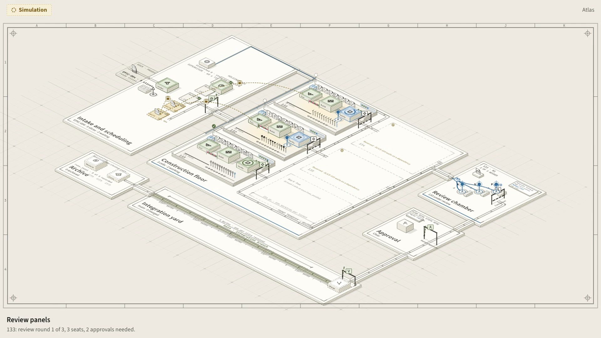
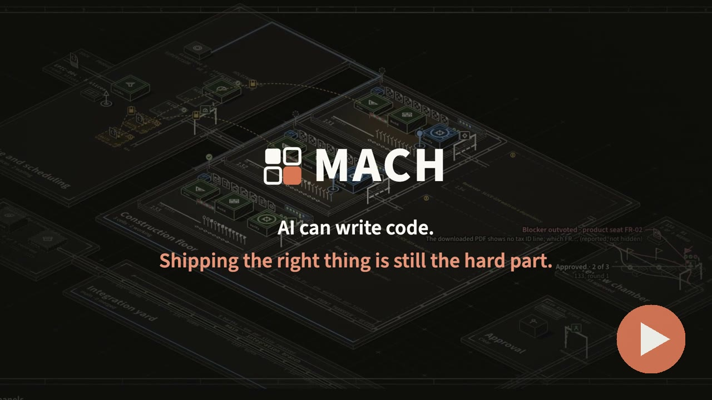
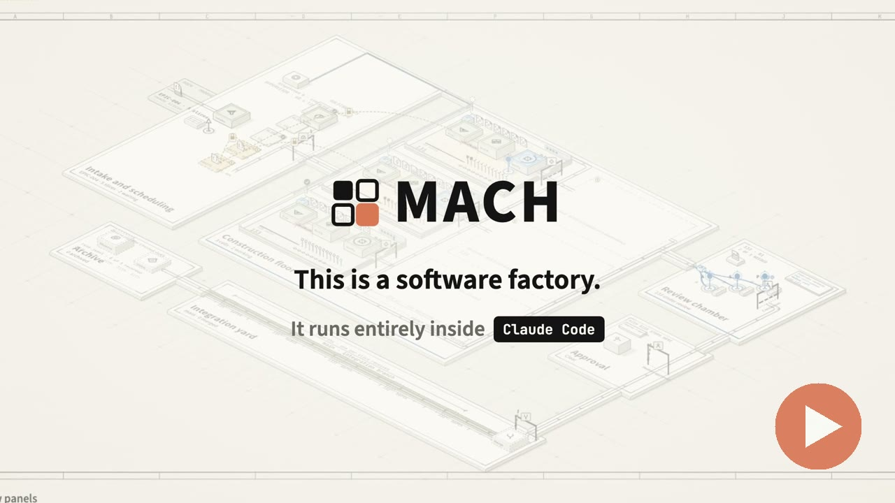
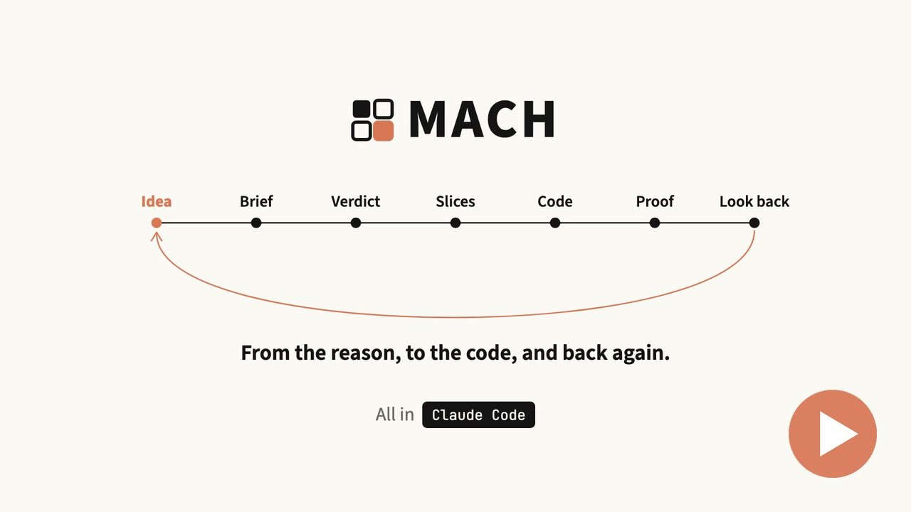
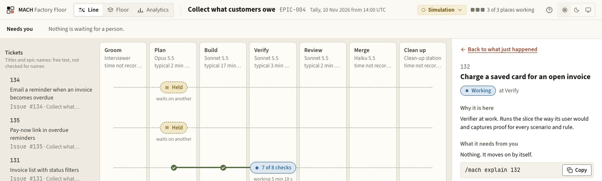
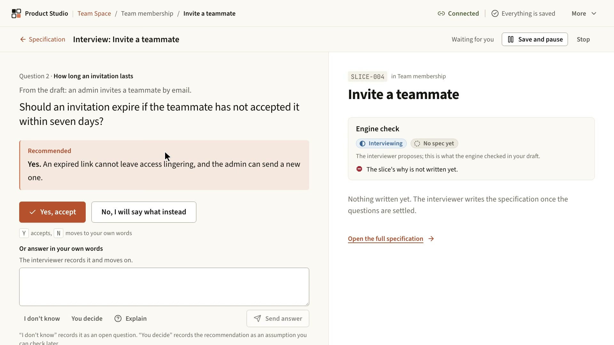
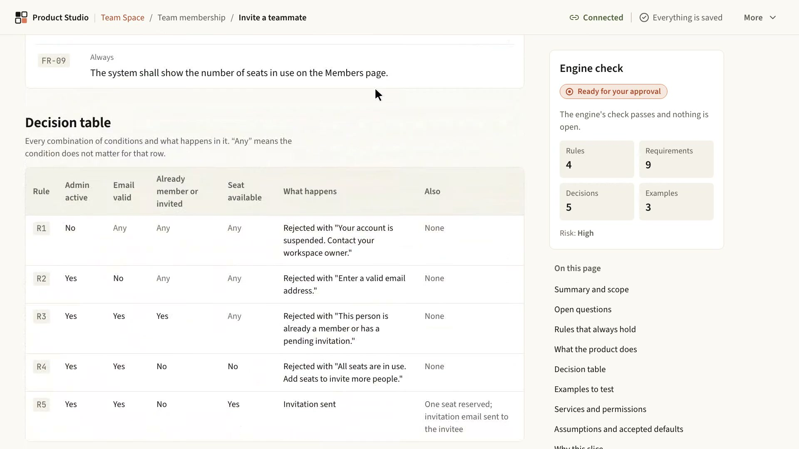
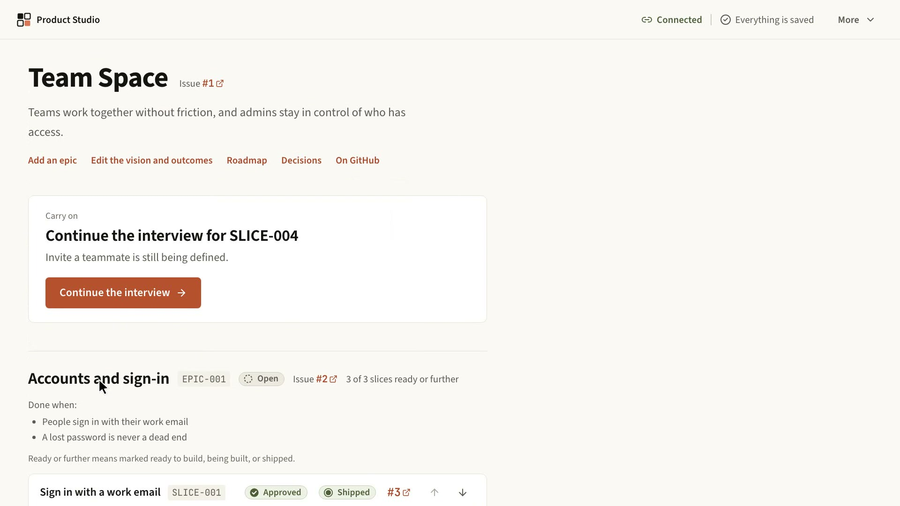
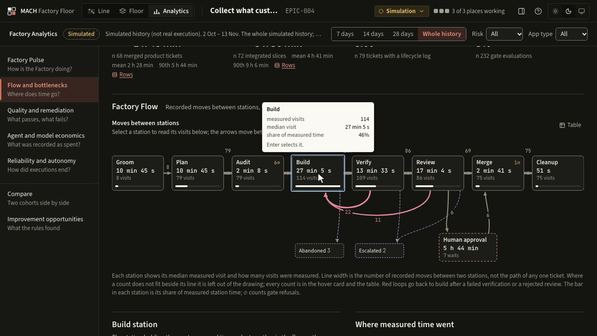
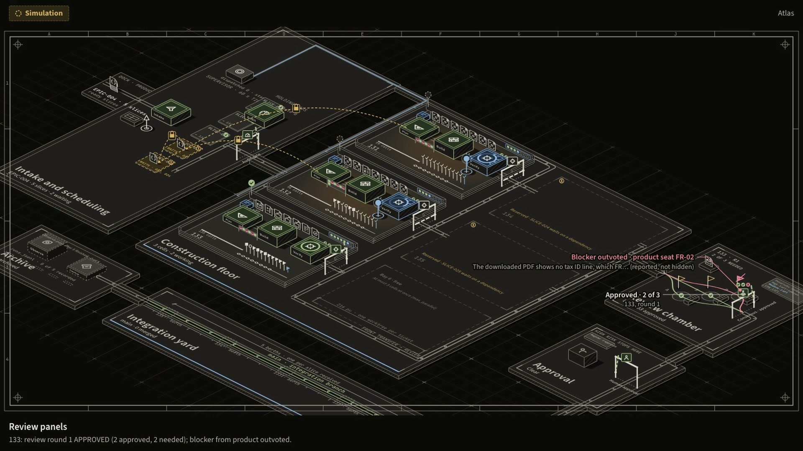

# MACH

MACH (Multi-Agent Construction Harness) is a software factory for Claude Code. A product manager describes what is wanted; the factory turns each piece into a checked specification, builds it test-first in an isolated workspace, proves it works with captured evidence, has it reviewed by a panel of independent agents, and merges it. Every station hands the next one artifacts MACH has checked, not a claim that the work is done.

> **Status: 0.23.2.** [`docs/BLUEPRINT.md`](docs/BLUEPRINT.md) is the full blueprint.



*The Factory Floor, showing its built-in sample factory. [Two short films](#what-it-looks-like) show MACH at work.*

## Contents

- [What it looks like](#what-it-looks-like)
- [Who does what](#who-does-what)
- [Install](#install)
- [The two commands](#the-two-commands)
- [How work flows](#how-work-flows)
- [For product managers](#for-product-managers)
- [For engineers](#for-engineers)
- [When the factory needs you](#when-the-factory-needs-you)
- [Finding out where things stand](#finding-out-where-things-stand)
- [Every command](#every-command)
- [Settings](#settings)
- [Guides](#guides)

## What it looks like

| | | |
|---|---|---|
| [](https://youtu.be/M1HSnETFg5Q) | [](https://youtu.be/ejPnwHeqsI8) | [](https://youtu.be/ehJI7cH6bJs) |
| **[Introducing MACH](https://youtu.be/M1HSnETFg5Q)** (2 min). From product intent to merged code, for product managers and engineers. | **[The software factory in Claude Code](https://youtu.be/ejPnwHeqsI8)** (2 min). The factory itself: the floor, the line, and why MACH's rules, not the agents, decide what counts. | **[From idea to proof](https://youtu.be/ehJI7cH6bJs)** (3 min). One idea carried from the ideas board to a brief, your verdict, slices, shipped code, and back to you at look back. |

MACH runs in Claude Code. Two local pages, served on your own machine, show the work: Product Studio for the product manager and the Factory Floor for whoever is watching the line.

**The Line.** Every ticket at its station, why it is waiting, where the time went and the command that moves it on.



| | |
|---|---|
|  |  |
| **The interview.** One yes-or-no question at a time, each with a recommended answer. | **The spec.** Requirements, a complete decision table and scenarios, written from the answers. |
|  |  |
| **Product Studio.** A project's epics and slices, and where each stands with the builders. | **Analytics.** Where time and rework go, from what the factory recorded. |



The Factory Floor pictures show the sample factory the page ships with, which it labels "Simulation". Product Studio's pictures use demonstration data.

## Who does what

| | Does | Never has to |
|---|---|---|
| **Product manager** | Describes the product, answers the interview, marks slices ready for the builders | Use Git, read code, or answer a technical question |
| **Engineer** | Installs MACH, takes approved work in, runs the line, approves high-risk changes | Write the spec, the tests or the code by hand |
| **The factory** | Grooms, plans, builds, verifies, reviews, merges, cleans up, and learns from finished tickets | Decide a high-risk change, or start on its own on a machine where nobody enabled it |

Some words used below:

- A **slice** is one thin, complete outcome for one kind of user, small enough to build and check in one go.
- A slice **marked ready** is saved as a GitHub issue under its epic's issue; that issue is how it reaches the builders.
- A **ticket** is one piece of work in the factory. A **cell** is the ticket's private workspace: its own Git worktree and branch, so nothing touches your main checkout until it is merged.
- A **station** is one step of the line (groom, build, verify, review, merge, clean up), run by its own agent with a fresh context.

## Install

You need Claude Code, `git` 2.36 or later, and `python3` 3.8 or later.

**As a plugin, for every project.** In Claude Code:

```
/plugin marketplace add swiftj/mach-harness
/plugin install mach@mach-harness
```

Then run `/mach:init` once in each project. It creates the factory files (`.factory/`, `REVIEW.md`, `AGENTS.md`, make targets, a MACH section in `CLAUDE.md`) and overwrites nothing that exists.

**With one command, for one project.** From the project's root:

```bash
curl -fsSL https://raw.githubusercontent.com/swiftj/mach-harness/main/install.sh | bash
```

This installs the newest release, after checking it, and prints one `MACH source:` line saying what it verified. Restart Claude Code afterwards. Run it again later to update.

Each install brings all of MACH's own files to the new version: its skills, agents and workflow in `.claude/`, and its files in `.factory/bin/` and `.factory/mach.mk`. MACH's scripts depend on each other, so they must all come from one version. If you or a Claude session changed one of those files, MACH saves your version in `.factory/mach-backup-<time>/` first and says so at the end. Your tickets, specs, settings and Product Studio drafts are never touched. `python3 .factory/bin/mach status` tells you if MACH's files do not match the installed version; running the installer again fixes that.

**Where MACH's own tickets go.** The first install chooses, and says which in a `tickets` line. In a Git repository whose `origin` remote is on GitHub, tickets MACH files itself, such as the hardening ticket a weak first audit asks for, are GitHub issues in that repository, named by their numbers (`/mach 12`). Anywhere else they are Markdown files in `.factory/tickets/`. To change it, set `"tickets.provider"` in `.factory/config.json` to `"local"` or `"github"`; an install never changes that setting once the file exists. If GitHub cannot take a ticket (no `gh`, not signed in, no network), MACH keeps it in `.factory/tickets/` and says why.

If it says the newest release could not be found, GitHub's API did not answer from your network (it allows a limited number of unsigned requests an hour). Name the release yourself:

```bash
curl -fsSL https://raw.githubusercontent.com/swiftj/mach-harness/main/install.sh | MACH_VERSION=0.23.2 bash
```

To install what is on the `main` branch ahead of the next release, use `MACH_REF=main` in place of `MACH_VERSION`; a branch install is not checksum-verified, and the installer says so.

**Then check the setup:**

```
/mach doctor
```

It checks Git, Python, Claude Code, your ticket tracker's sign-in and the MACH files, and lists what to do about anything missing. It changes nothing.

Both installs also fetch two small programs for the browser views (Product Studio's app and the Factory Floor), for Apple silicon Macs and Linux. What is downloaded, how it is verified, and the options to skip or pin a version are in [Installing](docs/guides/INSTALLING.md).

## The two commands

Almost everything goes through two commands.

| Command | For | What it is |
|---|---|---|
| `/mach-studio` | Product managers | The workspace for the project, its epics and slices, saved as GitHub issues |
| `/mach` | Engineers | The line: move a ticket, see the status of every ticket, take in product work, check the setup |

Both take plain words as well as the forms shown in this guide: "open the app", "what is LOCAL-004 waiting for?", "open the Factory Floor".

**Names.** With the one-command install the main command is `/mach`, and the others carry a dash: `/mach-studio`, `/mach-intent`. With the plugin every command carries the plugin's name and a colon, so the main one is `/mach:run` and the others `/mach:studio`, `/mach:intent`; Claude Code does not let a plugin's command be a bare `/mach`. This guide uses the first form. In a terminal, `mach` is a different thing: the installer (`mach install`, `mach status`, `mach uninstall`).

## How work flows

A request can start as a GitHub issue labelled `mach:request`; Product Studio shows it, and the product manager takes it from there.

```text
  PRODUCT MANAGER                      ENGINEER                        THE FACTORY
  /mach-studio                 /mach

  describe the project
  interview, one question
  at a time, per slice
  mark a slice ready
  (saved as a GitHub issue
  under its epic)  ─────────────►  take the work in  ───────────►  the issue is the ticket
                                   dispatch what is ready           groom ► plan ► build ► verify
                                                                    ► review ► merge ► clean up
                                   approve high-risk changes  ◄──  stops wherever a person is needed
  record acceptance  ◄───────────  qualify the release
```

A small team, or one person, can skip the left column: an engineer can groom an idea directly and run it down the line (see [One idea, start to finish](#one-idea-start-to-finish)).

## For product managers

Open Claude Code in the project folder and type:

```
/mach-studio
```

With nothing after it, it shows where things stand and suggests the next step. It also starts the visual app on your computer and shows its link: click it, or say "open the app", to work in your browser instead. The app and the conversation share the same drafts.

1. **Describe the project.** A name, a vision, and the outcomes you want for people. In the app, a new project first asks how you want to start: describe the product, start from a PRD, shape an idea first, or start from a request waiting on GitHub.
2. **Add an epic**, a larger capability that several slices of intent deliver. An epic needs no approval; each slice is approved on its own when you mark it ready.
3. **Start a slice.** Claude interviews you one question at a time. Each question is a yes-or-no proposal with a recommended answer:

   | You say | What happens |
   |---|---|
   | `yes` | The recommendation is accepted. |
   | `14 days, not 7` | Your answer is used. |
   | `I don't know` | It becomes an open question with a note on who can answer it. Nothing is guessed. |
   | `you decide` | The recommendation is used and listed as an assumption for you to review. |
   | `I need to stop` | Your progress is saved. Say "continue SLICE-004" later. |

   You never argue scope or answer in technical terms: the interview cuts the idea down to the smallest complete outcome and reserves IDs for what it defers.
4. **Mark the slice ready** once the spec passes its checks and no question is open. It is saved as a GitHub issue under its epic's issue, with your approval recorded on it; the builders take it from there. Without GitHub on your computer it is written to a folder you can hand to an engineer. Marking a slice ready starts no engineering work by itself.
5. **Change a ready slice** by saying so: it is taken back from the builders, you revise it, and you mark it ready again. "Refresh" shows each slice's issue, whether the builders have it, and anything changed on GitHub after you approved it.

Everything you write is a private draft on your computer until you mark a slice ready. New to MACH and Claude Code: [Quick start for product managers](docs/guides/PRODUCT_MANAGER_QUICK_START.md). Full guide: [Product Manager Guide](docs/guides/PRODUCT_MANAGER_GUIDE.md).

### Starting from a GitHub issue

1. Someone files an issue in plain words. A person with write access to the repository labels it `mach:request`.
2. After a refresh it appears under Requests (say "show requests"). A request labelled by anyone else is listed as "not accepted", with the reason.
3. Say "pick up request 42". You choose the epic and a title, and are interviewed as usual. The issue's text is shown to you as what was asked for; it never answers a question for you.
4. The issue gets short comments with slice IDs and links as work moves: taken in, and a link to each slice's issue when it is marked ready.
5. When a slice made from it is marked ready, say "request 42 is met" and the issue closes.

### A small change

Optional. Most changes to a product that has shipped are small: a rule that is not holding, a changed sentence, a different default or limit. Say "a small change", or choose it in the app wherever a slice is started.

1. **A fix or an adjustment.** A fix is for a shipped rule that is not holding: you say what you saw, and MACH finds the rule. An adjustment changes wording, presentation, a default or a limit.
2. **A short interview.** You say what is so today and what should be so instead. MACH looks up the rest, proposes the whole spec at once, and reads back what changes, what stays the same and the scenarios. It asks at most five yes-or-no questions, then you confirm.
3. **MACH decides what is small**, by fixed rules: one kind of user and one epic, at most three rules and four scenarios, at most one shipped rule changed and none retired, no new permission, no policy concern, no exception to a principle, and risk no higher than Medium.
4. **When it is not small**, MACH says so in one sentence naming the rule, and the slice carries on as a full slice with every answer kept. It never trims your change to fit. You can make one a full slice yourself at any time.
5. **Nothing is checked less.** The builders plan, test, verify and review a small change exactly as they do a full slice.

### Shaping an idea before any epic

Optional, and one of the ways to start. Say "shape an idea", or open Shape in the app.

1. **Ideas.** One board for everything that might become work: something you typed, a request, an idea filed with `/mach-idea`, or a fault MACH recorded.
2. **Explore.** A conversation, one open question at a time. MACH looks up the facts instead of asking you: the shipped rules the idea would touch, similar ideas and requests, and the principles and policies it would run into.
3. **The brief.** One page that is yours: the problem, who has it, the outcomes with how you would know each was met, what you are not doing, and every assumption marked as assumed until someone confirms it. MACH checks it is complete.
4. **The case.** You make the case as a customer would hear it, and MACH asks the hardest questions it can find. Then you record a verdict in your own words: go, not now, or no. MACH never recommends one, and a no stays findable with its reason.
5. **Size and route.** After a go, MACH sizes the work from what the brief touches, by fixed rules: a small change, one slice, an epic, or several epics. For the last two it proposes a map; every outcome is carried by a slice or you say it is out of scope or for later. Nothing is created until you say so.
6. **Look back.** When a slice made from the idea ships, each outcome comes back with its "how we would know" for you to record: met, not met, or too early to say.

### Technical needs, and a design you already have

Optional. Say "technical needs", or open Technical needs in the app. It is where you tell the engineers what the product requires of whatever is built, without choosing any technology.

1. **Six questions**, one at a time, in plain words: who uses it and how many, what it keeps and how sensitive that is, what it must work with, what must never happen, which quality wins when two conflict, and what is already decided outside the product. "Nothing to say" is a fine answer.
2. **No technology.** MACH never suggests one, and refuses one in a need. If something really is decided already, it is recorded as a given, with who said so and when.
3. **Publish.** The needs go to the project's issue with your approval and to a folder you commit. Change a need later and each decision written for the older version is flagged for an engineer to look at; nothing is reopened.
4. **A design you already have.** Bring in an architecture or design document. MACH reads what it decides on each basic topic, citing lines, and names each place where it contradicts a need, a principle or a policy. You settle each one in your own words, then publish it for the engineers.

A slice made this way names the outcome it serves, so the record reads from the reason to the code and back. The brief never reaches the builders as instructions; the slice's spec stays the authority. You can also start from a rule that has shipped: on "How this epic works today", choose a rule and "change this".

## For engineers

### Before the first ticket

```
/mach doctor     is this machine and project set up?
/mach audit      is the repository ready for agents?
```

The audit runs your build, tests and linter and gives a tier. **Gold** allows full autonomy. **Silver** builds, with a person approving each change. **Bronze**, which includes any failing build or test suite, blocks autonomous work until the repository is hardened. A Gold or Silver audit stays good as tickets merge; it runs again after `audit.max_age_days` (30 days by default), after a build finds the tests failing before any change, or when you ask. A Bronze audit runs again once the main branch moves.

### Secrets and new dependencies

The build station will not commit anything that looks like a credential: a private key, a cloud or service token, an API key, a password in a URL, or a long random string assigned to a name like `secret` or `token`. It says which file and line. Keep real credentials in the environment or a secret store; in tests, build fake ones at run time. If what it found is not a secret, the builder says why, and the reviewers see it. At review, every secret candidate and every dependency the change adds or changes is listed for the security reviewer, who runs on the strongest model and must answer each one: is the secret real, is the dependency needed, pinned, maintained, and not a look-alike of a well-known package. A low-risk change with something flagged gets three reviewers instead of one.

This is not a vulnerability database. A model's knowledge ends at its training date, so a version found vulnerable since then is not caught here, and nothing does static analysis. If your team wants database-backed scanning, run your own scanner through Claude Code hooks or in CI; release qualification reads its reports from `.factory/release/scans/`. `security.scan.enabled: false` turns the check off; the review then says so, and the unattended Factory will not run.

### Architecture decisions

Record your technology decisions (stack, libraries, languages, component structure, API contracts, security standards) as ADRs: MADR files in `docs/adr/NNNN-title.md`, changed by you through ordinary pull requests. Only `status: accepted` binds the factory. One extra header field says what a decision covers:

```markdown
---
status: accepted
applies-to:
  - path:services/api/**
  - topic:database
---

# Use PostgreSQL for every service's own data
```

The contract engineer plans under the accepted ones and names each it relied on; a plan that touches files an ADR covers must name it. The builder follows them with no override, and the architecture reviewer checks the change against them. A plan that cannot follow one stops for you: record an exception for that ticket, or supersede the ADR and plan again. A choice no ADR covers arrives as a proposed ADR in the ticket's own change; for a high-risk ticket the build waits until you accept it. A decision accepted later binds tickets planned afterwards; work already planned is flagged, never restarted. The factory never accepts, changes or supersedes an ADR.

**A picture where it helps.** An ADR, and a ticket's plan, may carry a [Mermaid](https://mermaid.js.org) diagram when the structure or the sequence is the decision: component boundaries, a data flow, a state machine, a data model. GitHub draws it where you read the ADR. `/mach adr new` offers one only then, drafts it for you and asks whether it matches. Slice specs carry no diagrams.

**Nothing is planned until the basics are decided.** The factory does not guess your stack. Until each required topic has an accepted ADR on the main branch that names it (`topic:language`, `topic:framework`, `topic:storage`, `topic:testing`, `topic:deployment`, `topic:coding-standards` by default), tickets are groomed but not planned or built. An ADR may decide a topic does not apply ("This library stores no data"). Add your own topics to `adr.required_topics`; an empty list requires nothing. For an existing repository, `/mach adr baseline` reads the committed files (manifests, lockfiles, test and lint settings, CI, container and deployment files, migrations) and drafts one proposed ADR per missing topic, stating what the repository already does and listing what it could not tell as open points; for a new project it asks you instead. You correct them, accept them and commit them by pull request.

**Starting from what the product needs.** When the product manager has published technical needs or a design, `/mach adr baseline` reads them as evidence beside the code, so a new project with no code is not six questions from nothing. A drafted decision names the needs it serves (`serves: TN-01@2`) and offers at least two options. A given is quoted with who said it and comes to you as a point to confirm. Neither a need nor a design decides anything: only an ADR you accept does. `/mach adr overview` writes `docs/architecture/overview.md`, a map of the decisions with two diagrams; the ADRs remain the authority.

**Starting from your own technical documents.** If you already have an ARCHITECTURE.md, a design, stack or deployment notes, coding standards or ADRs in another format, name them (`/mach adr baseline --from <file or folder>...`, or answer when `/mach adr baseline` asks). They may be anywhere on your machine, as Markdown or plain text; PDFs are not read. MACH reads them all and drafts a proposed ADR for each required topic they decide, citing the document, its SHA-256 and its lines. It offers the other decisions they make as one list you take all, some or none of. Gaps and disagreements between documents, with the code or with a published need come to you as questions; a need stays the product manager's. MACH never edits or commits your documents, and it notices when one changes.

```
/mach adr list                 every decision, its status and what it applies to, and which required topics are missing
/mach adr new "<decision>"     a short interview, then the file is written as proposed for you to commit
/mach adr baseline             draft the missing required decisions from the repository and your technical documents, then settle what is open with you, one question at a time
/mach adr overview             write a map of the decisions: the parts, how data moves, and the decisions by topic
/mach adr accept <ADR-NNNN>... mark proposed files you have read as accepted; you commit them
```

### One idea, start to finish

```
/mach new "Let workspace admins invite a teammate by email"
```

MACH creates a ticket and a cell and interviews you, the same way as in Product Studio. On your yes it writes the why (`intent.md`), the spec, the boundary contracts and a test-first plan into the cell. Then:

```
/mach LOCAL-001
```

This moves the ticket from wherever it is to the next point where a person is needed. MACH reads what each station recorded and names the next step; a fresh agent does it; then MACH is asked again. You can name a ticket by its number alone: `/mach 1`.

An interrupted run loses nothing. Run the same command again and it resumes at the station it had reached.

For a fix or an adjustment to something that has shipped, say it is a small change when the interview starts, or label the ticket `small-change`. The interview is short: MACH proposes the whole spec and asks at most five questions. Fixed rules decide whether the change is small, when the spec is checked and again when the plan is. One that is not goes back to the full interview with its answers and its plan kept. Every station after grooming treats it as any other ticket.

### Approved product work

When a product manager marks a slice ready, it arrives as a GitHub issue (or, without GitHub, as a `product/ready/SLICE-NNN/` folder). To run the factory on whatever is ready:

```
/mach pull                take in every slice marked ready and start the next batch
/mach pull --dry-run      the same schedule, changing nothing
```

Pull takes each ready slice in (one that is not accepted is listed with its reason and never built), picks the next batch with the same rules as several tickets at once (below), starts those slices and carries on the tickets already in the line, and lists what waits and why and what waits for you. `--limit <n>` and `--sequential` run fewer at once. When everything that can move has stopped, it walks you through what waits for you. Pull runs while you are in the conversation; the unattended way is the supervisor (`/mach factory`).

To look, or to do one step yourself:

```
/mach product status      what is marked ready, and what is not accepted and why; changes nothing
/mach product intake      take each new slice revision in, once (the issue is its ticket)
/mach product plan        what is ready, active, blocked, and why
/mach product dispatch 41 the slice of issue #41, or its slice ID
/mach product import <folder>   a ready folder handed to you outside Git
```

Dispatch opens the cell and stops; `/mach <ticket>` then runs it. Nothing is dispatched without your command, except by the supervisor on a machine where you enabled it. The Factory tells the slice's issue as it goes: building, a question for the product manager, shipped (and closed once merged).

### Several tickets at once

```
/mach 2 3 5
```

MACH shows the schedule first, then runs the tickets with the belt workflow (`mach-belt`; `mach:belt` with the plugin). Each ticket is built, verified and reviewed in its own cell, and the run ends with what each one is waiting for.

MACH decides what may run together by fixed rules, and it only ever runs fewer than the limit, never more:

- No more than `factory.max_parallel` tickets run at once, and no more than `factory.max_parallel_high` of them High risk.
- A ticket waits for the tickets it depends on to be merged.
- Two tickets whose plans change the same file do not run at the same time.

| Add | To |
|---|---|
| `--dry-run` | See the schedule and the reason for every wait; nothing starts |
| `--limit 2` | Run at most two at once (the settings limit still applies) |
| `--sequential` | Run one at a time |

Only you can raise a limit: in the settings, or by telling Claude Code to raise it for one run. `/mach` with no ticket still shows the status of every ticket and starts nothing.

Inside one ticket, the build can also run in **lanes**: when the plan's author divided its tasks into parts that share no file (or marked which task needs which), each part is built at the same time by its own builder, in its own worktree, and MACH then joins them on the ticket's branch, one commit per task, and runs the whole test suite on the result. Up to `build.max_lanes` lanes run at once (3 by default; 1 builds one task at a time), using only the builder places, `factory.max_builders`, that other tickets leave free. A plan written without them is built one task at a time, as before. A lane that cannot finish is handed back and its tasks are built one at a time after the join; nothing stops the ticket. Lanes cost more tokens, since each builder reads the plan and code for itself. See the [Engineer Guide](docs/guides/ENGINEER_GUIDE.md#building-in-lanes).

### Working as a team

Several product managers and several engineers can use MACH on one repository at the same time, each on their own computer.

- **No slice belongs to anyone in advance.** Any engineer's factory can build any slice. When a factory starts one it says so on the slice's issue, and `/mach pull` on another machine skips it and takes the next ready slice nobody is building.
- **Nobody is locked out.** A slice is free again when its builder merges or abandons it, or goes quiet for three days (`intake.claim_stale_days`). An engineer can take one over at any time by saying so.
- **The shared main takes a slice once.** A factory that built the same slice later is told it already shipped, and its copy is not merged.
- **Merging checks the shared main.** Each ticket is tested against what is on the shared main at that moment. Use `merge.method: "pr"` for a team; `/mach doctor` says when the main branch should be protected.
- **Product managers are told, never overwritten.** A slice number two people took at the same moment, or project and epic text that someone else changed, is reported with a way to settle it.

More in the [Engineer Guide](docs/guides/ENGINEER_GUIDE.md) and the [Product Manager Guide](docs/guides/PRODUCT_MANAGER_GUIDE.md).

### Unattended, on a machine you choose

```
/mach factory enable
```

The supervisor keeps approved product work moving without you. It is off on every machine until an engineer enables it there, after reading exactly what will be allowed and confirming with a code. `/mach factory status`, `pause`, `resume`, `disable` and `stop` complete it. Read [Operator Security Guide](docs/guides/OPERATOR_SECURITY_GUIDE.md) first.

Issues that a production monitoring account files and labels itself can also be taken in: `/mach requests monitor` takes up to three per pass for grooming without a person. The supervisor does the same only where you add `--monitoring-requests` when enabling it; that is off by default, and it builds only what grooming rates below High risk.

### Watching it

Run `/mach floor`, or say "open the Factory Floor". It opens a read-only view in your browser: the Line (every ticket, station by station, and what needs you), the Floor (the factory as an isometric drawing) and Analytics (how well the factory runs). It cannot start, approve or merge anything.

### Releasing

```
/mach release qualify --epic EPIC-001
```

It checks, at one exact commit, that every slice of the epic (or of a list of slices you name) is merged, verified and reviewed, reruns the tests, and writes a readiness snapshot. It works on any machine with the main branch, including one that built none of the slices: MACH reads each slice from the change record merged with it. The product manager records acceptance as a comment on the epic's issue. It never tags or deploys.

Full guide: [Engineer Guide](docs/guides/ENGINEER_GUIDE.md).

## When the factory needs you

When a run stops for you, MACH walks you through it: one ticket at a time, what happened, then a prompt with the options that ticket really has. MACH lists the options by fixed rules, so they are the same every time, and where a rule decides it, one is marked as recommended. You pick one, or skip it and nothing changes. To come back to it later:

```
/mach decide
```

These are the cases, and what each choice runs if you would rather type it yourself.

| It says | What to do |
|---|---|
| The spec has open questions | Finish the interview: `/mach <ticket>` continues it |
| Waiting for a person's approval (a high-risk change, or a Silver repository) | Read the findings it shows, then `/mach approve <ticket>`. It records your approval and carries the ticket on to the merge and cleanup. To have something changed first: `/mach send-back <ticket> "<why>"`. Your reason goes to the builder as the finding to answer, and it uses one of the ticket's three rounds |
| The review's security veto rejected a round | The builder fixes it as usual. If you have read the finding and accept it for this commit, say so: `/mach except <ticket> <round>/<seat>/<n> "<why>"`, before the builder starts again, naming every vetoing blocker you accept. A reviewer whose only blockers you excepted then counts as approving, so this works at any risk tier; a reviewer with any other blocker still rejects, and MACH refuses if the round would still fail. Only a blocker that vetoed can be excepted, never an ordinary one. It is not an approval: a high-risk change still needs yours. It holds only for the commit reviewed, and until the date you give with it |
| A security exception has expired | Record a new one the same way, or abandon the ticket. Nothing merges past an expired exception |
| Approved, waiting for a person to merge | `/mach merge <ticket>` |
| Blocked: escalated after three rounds | `/mach explain <ticket>`, then fix it yourself or abandon it: `/mach abandon <ticket> "<why>"` |
| The repository is Bronze | `/mach audit` lists what to fix |
| A build stopped at a gate before any review | Run it again, or start the plan over: `/mach replan <ticket> "<why>"` |
| A worker is already on this ticket | Wait for it; or, if that worker is gone, tell Claude Code to take over |
| The plan cannot follow an architecture decision | Record an exception for this ticket: `/mach adr except <ticket> <ADR-NNNN> "<why>"`. Or supersede the ADR by pull request, then `/mach replan <ticket> "<why>"` |
| A high-risk ticket proposes a new architecture decision | Read the proposal, then `/mach adr accept <ticket> <ADR-NNNN>`; it is accepted on the ticket's branch and lands with the change |
| An ADR file cannot be read | Fix it by pull request; `/mach adr list` names the problem, and `/mach <ticket>` plans the ticket once it is fixed |
| The project's basic technical decisions are not written down | `/mach adr baseline`: it drafts them, asks you about what the repository does not show, and accepts them on your word; put them on the main branch (it offers a pull request, or a direct commit if `adr.landing` is `main`; MACH needs no review of its own); `/mach <ticket>` plans the ticket once they are merged |
| The audit is missing or out of date | `/mach audit` |

A ticket gets three judging rounds in all, counting failed verifications and rejected reviews. On the third failure it is handed to a person; the factory does not keep trying.

### Being told when the factory is waiting

MACH can tell you when a ticket that nobody is watching stops for a person. It is off until you turn it on, on each machine, and there are two ways; use either or both.

**A banner on your Mac** (macOS only):

```
/mach notify banner on
/mach notify test
```

macOS may hide banners from scripts until you allow notifications for the program it names (usually Script Editor) in System Settings. MACH can tell that the banner command ran, not that macOS showed it, so run the test once and look.

**A message to a channel.** Put your channel's webhook address in a file yourself (it is a secret, so don't paste it into the conversation), then:

```
/mach notify set --from-file ~/hook.txt --label "Shop team"
/mach notify test
```

Delete the file afterwards. A message names the ticket, says what is needed in a fixed sentence, and gives the command to run (`/mach decide`). It never includes a title, reviewer text, a name or a link, and it can approve nothing. `/mach notify` shows what is on and the last message sent; `/mach notify off` removes the address and `/mach notify banner off` turns the banner off. Slack and Discord webhook addresses both work.

## Finding out where things stand

```
/mach status              every open ticket and its next step
/mach explain LOCAL-004  why this ticket failed or is waiting
```

Every status opens with three lines:

```text
Where: LOCAL-004: stage built; next: revise. The review rejected this build.
A person must decide: Nothing
Time and cost: 42 min recorded; cost not recorded
```

A cost appears only where one was recorded, which today means work the supervisor ran. It is never estimated.

`explain` names the requirement or scenario that failed, the check or test that showed it, each reviewer's blocker with the rule it cites, and how many of the three rounds are used.

## Every command

`/mach-studio` and `/mach` are the ones to remember. The station commands at the bottom of the table still work and you can run any of them yourself, but `/mach` calls them for you.

| Command | What it does |
|---|---|
| `/mach-studio` | Shape an idea before any epic (brief, case, verdict); project, epics, slices; a small change; mark a slice ready (a GitHub issue); requests from GitHub issues; `refresh`; "open the app" |
| `/mach-idea` | For anyone: describe an idea in your own words and send it to the product team as a GitHub issue (or get the text to paste) |
| `/mach <ticket>` | Move one ticket to the next point a person is needed |
| `/mach <ticket> <ticket> ...` | Run several tickets, scheduled by MACH's rules; `--dry-run`, `--limit <n>`, `--sequential` |
| `/mach status` | Every open ticket and its next step |
| `/mach studio` | Open Product Studio in your browser |
| `/mach floor` | Open the Factory Floor in your browser: a read-only view of the factory |
| `/mach explain <ticket>` | Why a ticket failed or is waiting |
| `/mach decide` | Walk through every ticket that waits on you, with its options |
| `/mach doctor` | Check this machine and project; `--fix` creates missing MACH folders only |
| `/mach notify [set\|banner\|test\|off]` | Tell you when a ticket waits for a person, by a banner on your Mac, a message to a channel, or both; off until you turn it on, on this machine |
| `/mach new "<idea>"` | Start the interview for a new idea |
| `/mach approve <ticket>` | Record your approval of a change that needs a person, then carry the ticket on |
| `/mach send-back <ticket> "<why>"` | Send a change the panel approved back to the builder, with your reason |
| `/mach except <ticket> <round>/<seat>/<n> "<why>"` | Accept a security blocker that vetoed a round, for the commit reviewed, with your reason; never offered unprompted, never unattended |
| `/mach merge <ticket>` | Merge an approved ticket yourself |
| `/mach replan <ticket> "<why>"` | Start a ticket's plan over, before any review round; the old plan is kept |
| `/mach abandon <ticket> "<why>"` | Drop a ticket; its work is kept first (in its archive, or in Git) |
| `/mach adr list` | Every architecture decision: ID, title, status, what it applies to, problems |
| `/mach adr new "<decision>"` | A short interview, then a new ADR written as proposed for you to commit by pull request |
| `/mach adr except <ticket> <ADR-NNNN> "<why>"` | Let one ticket depart from an accepted ADR, with your reason |
| `/mach adr accept <ticket> <ADR-NNNN>` | Accept the ADR a ticket proposes, on that ticket's branch |
| `/mach adr baseline [--from <file or folder>...]` | Draft the required basic decisions (language, framework, storage, testing, deployment, coding standards) from the repository and the technical documents you name |
| `/mach adr overview` | Write the architecture overview, a map of the decisions with two diagrams, for you to commit |
| `/mach adr accept <ADR-NNNN>...` | Mark proposed ADRs in your working tree accepted; you commit them |
| `/mach audit` | The repository's readiness tier |
| `/mach pull [--limit n] [--sequential] [--dry-run]` | Take in every slice marked ready and start the next batch |
| `/mach product status\|intake\|import\|plan\|dispatch` | Take slices marked ready into the factory, one step at a time |
| `/mach factory status\|enable\|pause\|resume\|disable\|stop` | The unattended supervisor on this machine |
| `/mach release status\|qualify\|show` | Is an epic, or a set of slices, ready to release, at one commit |
| `/mach-intent <ticket or idea>` | The interview, spec, contracts and plan; `--headless` when no person can answer |
| `/mach-build <ticket>` | Build test-first inside the cell; the separate parts of a plan written in parts are built at the same time, in lanes |
| `/mach-verify <ticket>` | Prove the built slice with captured evidence |
| `/mach-review <ticket>` | The review panel; `approve --by <name>` records a person's approval |
| `/mach-merge <ticket>` | Land exactly the approved commit; `--by-person` to merge it yourself |
| `/mach-cleanup <ticket>` | Remove a finished cell, keeping its archive when `cleanup.archive` says to; `--abandon "<why>"` to drop one; `forget` to clear what was kept |
| `/mach-observe` | Scorecard of finished tickets and proposed rule changes |
| `/mach-audit` | The repository's readiness tier |
| `/mach-ticket list\|view\|create\|update\|comment\|ingest-telemetry` | The ticket queue, and crash reports turned into tickets |
| `/mach:init` | Plugin only: create the factory files in a project |

Outside Claude Code: `make mach-status` (what is installed and the open cells), `make mach-cells` (the worktrees behind them), `make mach-uninstall`.

What each station checks and refuses is in the [Station Reference](docs/guides/STATION_REFERENCE.md).

## Settings

Settings are in `.factory/config.json`. The ones people change most:

| Setting | Default | Meaning |
|---|---|---|
| `tickets.provider` | `github` when the project's `origin` remote is on GitHub, otherwise `local` (set by the installer) | Where tickets live, MACH's own included: `local` (Markdown files in `.factory/tickets/`), `github`, `gitea-cli`, `jira`, `fossil`. A ticket the tracker cannot take is kept in `.factory/tickets/`, and MACH says why |
| `merge.mode` | `auto` | `auto` lets the line merge approved tickets; `manual` leaves every merge to you |
| `merge.method` | `local` | `local` makes a merge commit; `pr` opens a pull request that refers to the request's issue, and merges the approved commit |
| `merge.auto.<tier>` | `true` | Set a risk tier to `false` to keep its merges for a person |
| `review.<tier>` | see file | Reviewers, approvals needed, and whether a person must approve |
| `security.scan.enabled` | `true` | The secrets gate at build and the secrets and dependency list at review. Off: the review says so, and unattended work is refused |
| `review.security_exception_by` | `[]` | Names of the people who may except a security blocker; empty means any person. It guards against accident, not forgery |
| `factory.max_parallel` | `3` | How many tickets may run at once |
| `factory.max_parallel_high` | `1` | How many High-risk tickets may run at once |
| `factory.max_builders` | `factory.max_parallel` | How many builders may run on this machine across every ticket. Lanes use only the places other tickets leave free |
| `build.max_lanes` | `3` | How many parts of one ticket's plan may be built at the same time, in lanes. Only a plan written for it (in parts, or with `after` marks) is built this way. `1` builds one task at a time |
| `cleanup.archive` | `raised` | Whether cleanup keeps a finished ticket's archive (its records and evidence files) in `.factory/archive/`: `none`, `raised` (only for a ticket a person decided something on) or `all`. With none, what you might want back stays in Git; `cleanup.py forget` clears what was kept |
| `factory.claim_minutes` | `90` | How long a worker's claim on a ticket holds without news of it, before another worker may take the ticket |
| `factory.notifications` | not set | `false` forbids notifications for this project on every machine. Nothing in this file can turn them on |
| `merge.pr.inline_findings` | `true` | With `merge.method` `pr`, post the review panel's findings on the pull request |
| `build.commands.test_file` | worked out | How to run only some test files, with `{files}` where their paths go, for example `pytest {files}`. The build station uses it to see a new test fail in seconds. It is worked out for Python's unittest and pytest; set it for other test runners. It is used only if a committed test passes when run this way |
| `commands.env` | not set | Extra environment variables for every project command MACH's stations run, as a map of names to values. `{cache}` is MACH's cache folder (`.factory/cache`) and `{project}` the project's folder, for example `"CARGO_HOME": "{cache}/cargo"`. A command's own leading `VAR=value` wins over it; it wins over your environment and over MACH's own choice. Never put a credential here |
| `models.*` | `fable`, `opus`, `sonnet`, `haiku` | The model tier for planning, contracts, building and utility work |
| `tickets.github.request_label` | `mach:request` | The label a person with write access applies to turn an issue into a request |
| `tickets.github.status_comments` | `true` | `false` stops MACH's comments on request issues; its labels are still set |
| `adr.dir` | `docs/adr` | The folder of the project's architecture decision records |
| `adr.required_topics` | the six basics | Topics that need an accepted ADR before any ticket is planned. Add names to extend it; `[]` requires nothing |
| `intent.small_change` | `requirements` 3, `scenarios` 4, `questions` 5, `changed_shipped_rules` 1 | The most a small change may hold: rules, scenarios, questions asked, and shipped rules changed. The last can only be lowered |
| `floor.evidence_media` | off | Let the Factory Floor's evidence player show screenshots and recordings; transcripts and other text are shown either way |

A high-risk change always needs a person's approval in review unless you change that setting yourself. `REVIEW.md` and `AGENTS.md` are yours to edit once created.

## Guides

| Guide | For |
|---|---|
| [Quick start for product managers](docs/guides/PRODUCT_MANAGER_QUICK_START.md) | New to MACH and Claude Code: set up, then a first slice from a PRD or from an idea |
| [Product Manager Guide](docs/guides/PRODUCT_MANAGER_GUIDE.md) | Product Studio from first project to recorded acceptance |
| [Engineer Guide](docs/guides/ENGINEER_GUIDE.md) | Intake, the supervisor, human gates, recovery, release qualification |
| [Station Reference](docs/guides/STATION_REFERENCE.md) | What each station does and what it refuses |
| [Installing](docs/guides/INSTALLING.md) | The browser programs and what the installer verifies |
| [Operator Security Guide](docs/guides/OPERATOR_SECURITY_GUIDE.md) | What an unattended run can reach, and the limits to know |
| [`docs/BLUEPRINT.md`](docs/BLUEPRINT.md) | The full blueprint |

## Uninstall

Script install or scaffold, from the project's root:

```bash
python3 .factory/bin/mach uninstall
```

Plugin:

```
/plugin uninstall mach@mach-harness
```

Uninstall removes exactly the files MACH installed and you have not changed (and Python's compiled copies of those scripts, which it lists), and takes its section back out of `CLAUDE.md` and `.gitignore`. A file you edited is kept and reported; `--force` removes it after saving a backup in `.factory/mach-backup-<time>/`. Your tickets, specs, cells and archives are your project's data and are never touched. An untouched project is left byte-for-byte as it was.

## Developing MACH

```bash
make test        # validator, cell gates, ticket adapter, audit, build, verify, review, merge, cleanup and observe gates, installer round trips
make validate    # plugin and marketplace manifests
```

To try the plugin from a clone without installing it: `claude --plugin-dir /path/to/mach-harness`.

| Path | Purpose |
|------|---------|
| `skills/ticket/` | The ticket skill: `SKILL.md` and `ticket.py` (trackers and telemetry). |
| `skills/audit/` | The audit skill: `SKILL.md` and `audit.py` (scorecard and gate). |
| `skills/build/` | The build skill: `SKILL.md` and `build.py` (start gates, red/green enforcement, build report). |
| `skills/verify/` | The verify skill: `SKILL.md`, `verify.py` (evidence records and verdict) and the per-app-type runner guide. |
| `skills/review/` | The review skill: `SKILL.md`, `review.py` (panel, votes, tally), the reviewer brief and one checklist per seat. |
| `skills/merge/` | The merge skill: `SKILL.md` and `merge.py` (commit-bound approval, revalidation, local or pull-request merge). |
| `skills/cleanup/` | The cleanup skill: `SKILL.md` and `cleanup.py` (what is kept, teardown, run record, forget). |
| `skills/observe/` | The observe skill: `SKILL.md` and `observe.py` (scorecard, patterns, report check). |
| `skills/run/` | The orchestrator: `SKILL.md` and `run.py` (what happens next to a ticket). |
| `workflows/belt.js` | The Dynamic Workflow that runs several tickets in parallel. |
| `skills/intent/` | The grooming skill: `SKILL.md`, templates, grammar references, `validate_slice.py`, `cell.py`. |
| `skills/init/` | Plugin-only wrapper around `bin/mach scaffold`. |
| `agents/contract-engineer.md` | Stage 2 of grooming, pinned to the `opus` tier. |
| `agents/builder.md` | The build station, pinned to the `sonnet` tier. |
| `agents/verifier.md` | The verify station, pinned to the `sonnet` tier, always a fresh context. |
| `agents/reviewer.md` | One seat on the review panel; the review station sets its model per seat. |
| `apps/studio/`, `apps/observer/` | The Product Studio host and the Factory Floor's read-only observer (Go), each with `build.sh` (embeds its web app) and `smoke.sh`. |
| `bin/mach`, `install.sh` | The installer. |
| `templates/` | What gets scaffolded into a project. |
| `docs/` | The guides (`docs/guides/`), the original design notes for each station, and the prd-slice skill the interview is adapted from. |

When you change the validator, change its references, the fixture in `tests/fixtures/`, and the tests together: a test fails if any rule code the validator can emit is missing from `skills/intent/references/`.

### Releasing

Set the new version in `.claude-plugin/plugin.json`, merge to `main`, then push a tag `v<version>`. The `release` workflow tests, builds the Product Studio host and the Factory Floor's observer for each machine with their web apps embedded, packages the repository at the tag as `mach-<version>-source.tar.gz` (what `install.sh` installs) and installs it into an empty project as a smoke test, writes `SHA256SUMS` for all of them, attests the build provenance of the programs, the source archive and `SHA256SUMS`, writes an SBOM for each program, and publishes the GitHub release the installer downloads from. The tag must match the plugin's version or the workflow stops.

Before publishing, each program is started on a runner of its own kind (`apps/studio/smoke.sh`: open the one-time link, load the app, ask the engine for status; `apps/observer/smoke.sh`: open the link, read the API, check that only GET is answered, stop cleanly). Running the workflow by hand from the Actions tab builds and smoke-tests everything and publishes nothing.

## License

MIT. See [LICENSE](LICENSE).
